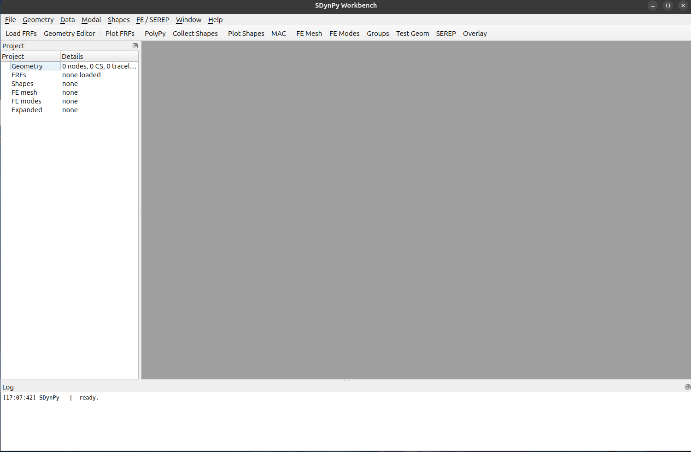
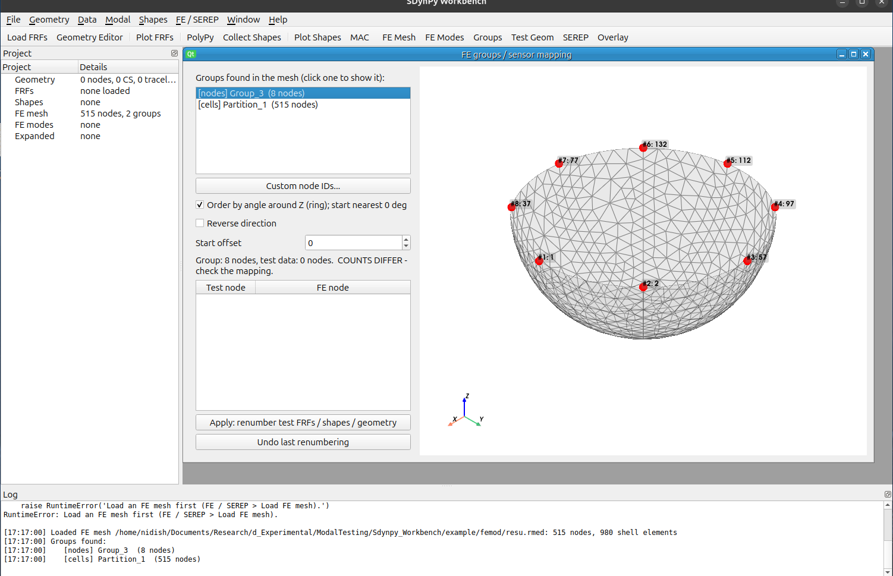
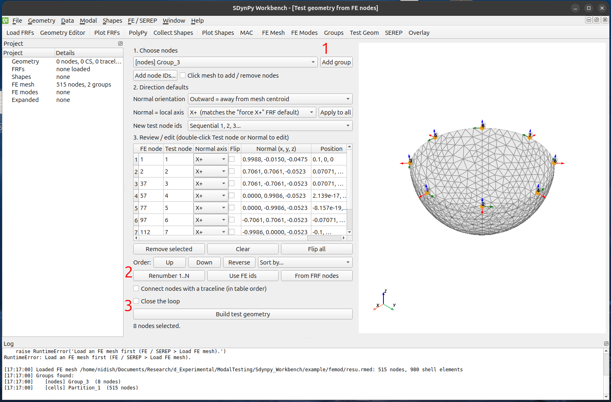
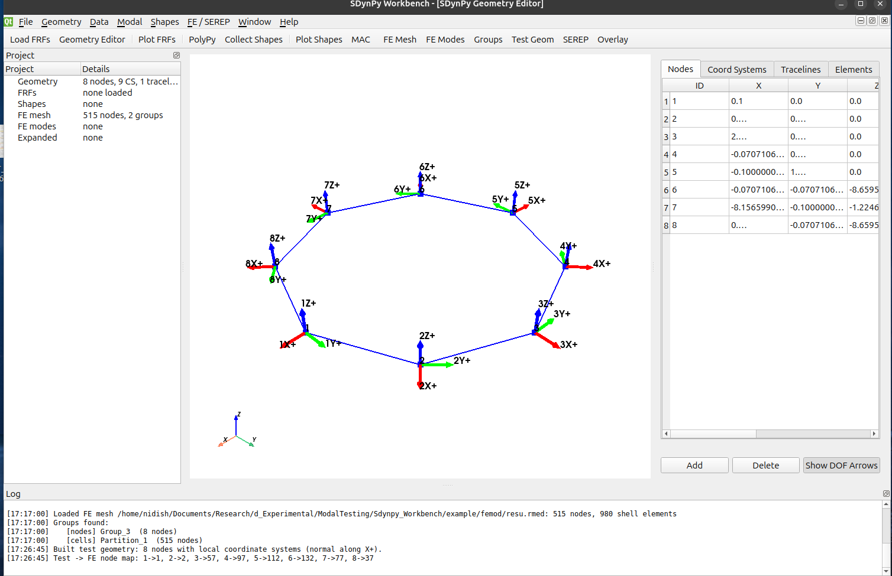
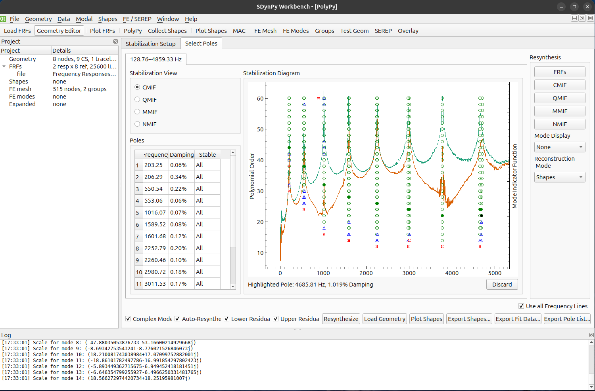
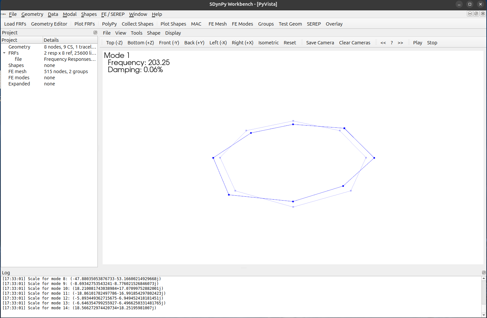
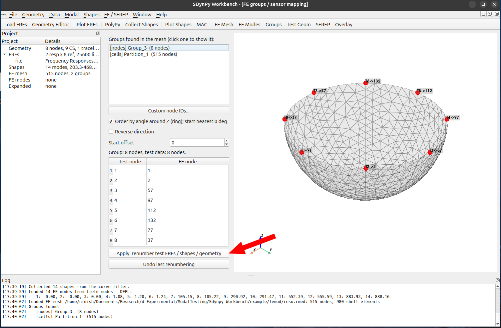
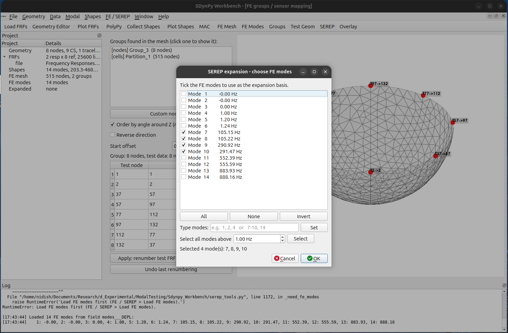
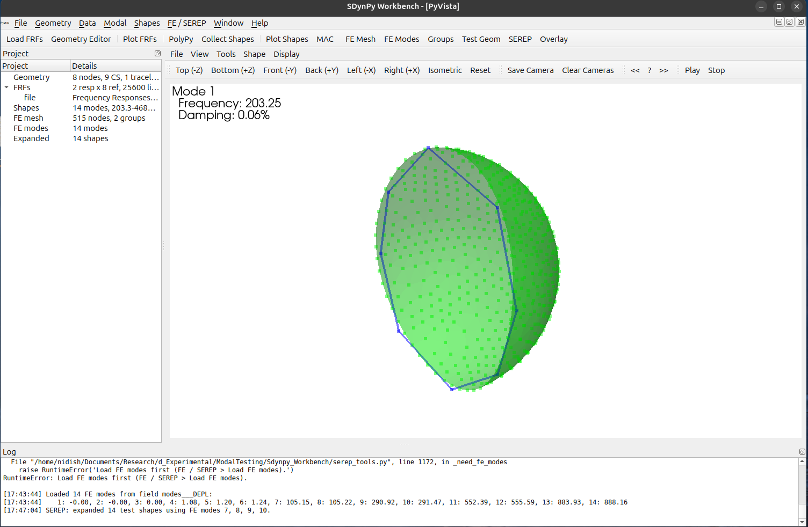
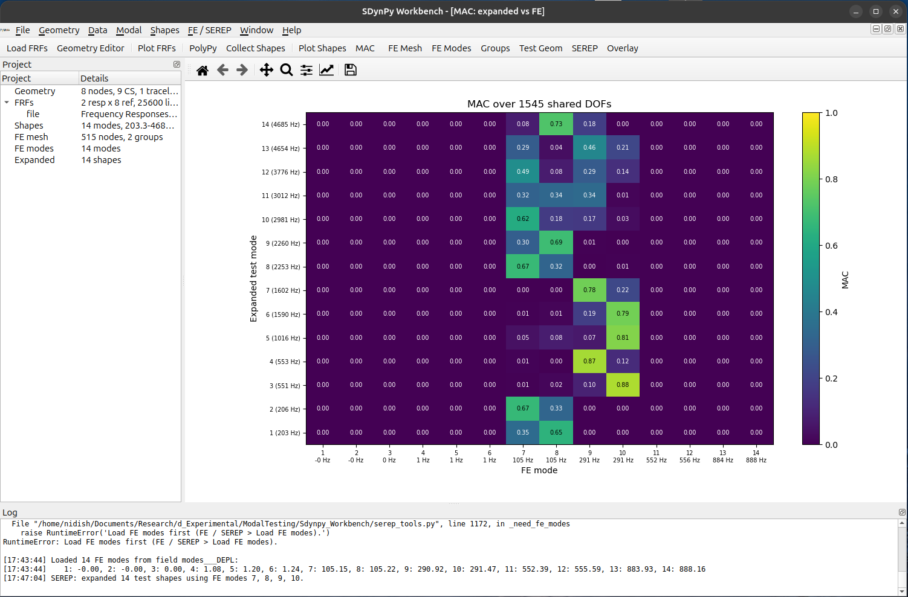

#+title: SDynPy Workbench
#+subtitle: User Guide and Example Workflow
#+author: Nidish Narayanaa Balaji
#+date: October 16, 2026
#+options: toc:2 num:t ^:{}
#+latex_header: \usepackage[margin=1in]{geometry}
#+latex_header: \usepackage[subrefformat=parens,labelformat=parens]{subcaption}
#+latex_header: \usepackage{siunitx}
#+latex_header: \usepackage{xcolor}
#+latex_header: \usepackage{accents}
#+latex_header: \usepackage{minted}
#+latex_header: \usepackage{cancel}
#+latex_header: \newcommand{\vc}[1]{\underbar{$#1$}}
#+latex_header: \newcommand{\mx}[1]{\mathbf{\underline{\underbar{$#1$}}}\,}
#+latex_header: \newcommand{\uc}[1]{\underaccent{\tilde}{#1}}
#+latex_header: \usepackage{cleveref}
#+latex_header: \hypersetup{colorlinks=true,linkcolor=blue,urlcolor=blue,citecolor=blue}

* Introduction
:PROPERTIES:
:UNNUMBERED: t
:END:

The *SDynPy Workbench* is a graphical front end built around [[https://sandialabs.github.io/sdynpy/][SDynPy]] for organizing the main stages of experimental modal analysis and finite-element (FE) mode-shape expansion. It brings geometry editing, frequency-response-function (FRF) inspection, modal curve fitting, shape visualization, FE data handling, SEREP expansion, and project saving into one desktop application.

This guide demonstrates a representative workflow using impact-hammer modal-test data from a metallic bowl and an FE model prepared in [[https://open-simulation-center.org/fr/downloads/code_aster/SALOME_MECA][Salome-Meca]] with Code_Aster. The experimental setup has two response sensors and eight impact locations. The measured FRFs are curve-fitted to estimate experimental mode shapes; the FE modes are then used as a basis to expand those shapes using the *System Equivalent Reduction Expansion Process (SEREP)* implemented through SDynPy.

The example is deliberately workflow-oriented. Your file formats, channel directions, node identifiers, selected modes, and geometry may differ. Check each mapping before running the expansion.

* Workflow at a glance

The recommended sequence for the example is:

1. Launch the Workbench.
2. Load the FE mesh and identify the nodes corresponding to the test locations.
3. Build the test geometry, including node ordering, tracelines, and local coordinate systems.
4. Load and inspect the measured FRFs.
5. Fit the experimental data using PolyPy (or SMAC, where appropriate).
6. Plot the fitted shapes and collect them into the Workbench project.
7. Map test node identifiers to the corresponding FE node identifiers.
8. Load the FE mode shapes and select a suitable expansion basis.
9. Run SEREP, inspect the expanded shapes, and compare them with the FE modes using MAC.
10. Save the project so the session can be resumed later.

#+begin_quote
*Important:* SEREP depends on a consistent relationship between the experimental coordinates and the FE model. Before expanding shapes, verify node identity, node ordering, coordinate directions, and the selected FE basis. A visually plausible plot alone does not prove that the mapping is correct.
#+end_quote

* Launch the Workbench

Run the application from the directory containing the Workbench scripts:

#+begin_src shell
python3 sdynpy_workbench.py
#+end_src

The application is built on SDynPy and uses Qt for the desktop interface, Matplotlib for plotting, and PyVista/VTK for 3-D visualization. The companion modules =serep_tools.py= and =project_io.py= must be available alongside =sdynpy_workbench.py= (or otherwise importable by Python). The required Python packages must already be installed in the environment used to launch the program.

#+name: fig:wb1
#+attr_latex: :width 0.92\linewidth :placement [!htbp]
#+caption: SDynPy Workbench launch screen.

The main window is organized around a project tree, a central workspace for tool windows, and a log panel. The project tree summarizes the data currently loaded; the log panel is useful when checking progress or diagnosing an error. SDynPy tool windows are hosted inside the Workbench workspace so that related plots and editors can be arranged together.

** Ways to get started

There are two common starting points:

- *FRFs first:* use =Load FRFs= to load measured frequency-response functions, then inspect them with =Plot FRFs= and fit them with =PolyPy= or =SMAC=. Without geometry, you can still inspect data and perform fitting, but you cannot meaningfully display the resulting shapes on a test geometry.
- *Geometry first:* use =Geometry Editor= to create or edit nodes, coordinate systems, tracelines, and elements. Geometry can also be imported or generated using the Geometry menu. Once geometry and FRFs are available, the fitted shapes can be visualized on that geometry.

For the FE-assisted workflow described below, load the FE mesh first so that the test geometry can be built from known FE nodes.

* Prepare the finite-element and test geometries

** Load the FE mesh

1. Click =FE Mesh= on the SEREP toolbar (or use the corresponding FE/SEREP menu command).
2. Select the mesh file. The Workbench accepts MED-family files such as =.med= and =.rmed=.
3. Confirm that the mesh and its node groups have been read correctly.

In this example, the result file =resu.rmed= contains the mesh and the node group associated with the experimental sensor locations. The group shown in the screenshot is named =Group_3=. Group names depend on how the mesh was created and exported; select the group that actually contains the required test nodes in your model.

#+name: fig:femesh
#+attr_latex: :width 0.92\linewidth :placement [!htbp]
#+caption: Workbench after loading the FE mesh and inspecting the available node groups.

The mesh viewer and group list are intended to help identify the relevant nodes. If the expected group is absent, check the groups or tags exported with the mesh. You can also enter a custom list of FE node IDs in the sensor-mapping tool.

** Build the test geometry

Click =Test Geom= to open the geometry builder. This creates a test geometry from a subset of the FE mesh nodes.

#+name: fig:testgeom
#+attr_latex: :width 0.92\linewidth :placement [!htbp]
#+caption: Test-geometry builder opened from the loaded FE mesh.

Follow these steps in the builder:

1. *Select the node group.* Click =Add group= and choose the group containing the test locations. Check that the highlighted nodes are the intended measurement locations.
2. *Match the experimental ordering.* Reorder or renumber the selected nodes so that their sequence matches the test-data channel/node ordering. This is important: a correct set of nodes in the wrong order can still produce an incorrect mapping.
3. *Create tracelines.* Add tracelines to connect nodes in a useful order for visualization. Tracelines help display the geometry; they do not replace the node mapping required for SEREP.
4. Click =Build test geometry= to create the geometry.

#+name: fig:testgeomar
#+attr_latex: :width 0.92\linewidth :placement [!htbp]
#+caption: Test geometry displayed in the SDynPy Geometry Editor, with degree-of-freedom arrows enabled.

Open =Geometry Editor= to inspect the result. Use =Show DOF Arrows= to check the local coordinate systems and directions at the measurement locations. For measurements made along local sensor axes, make sure those axes are consistent with the directions represented by the FRF channels and the FE degrees of freedom.

** Alternative geometry workflows

The Workbench also supports several ways to create or edit geometry:

- =Geometry Editor= opens SDynPy's interactive geometry editor for editing nodes, coordinate systems, tracelines, and elements.
- =Generate ring of sensors...= creates a ring of nodes, with configurable node count, diameter, height, coordinate-system convention, and an optional closed traceline.
- =Import nodes from CSV...= imports nodal coordinates. The expected columns are =id, x, y, z=, with optional =def_cs= and =disp_cs= columns.
- =Import UFF/UNV geometry...= imports geometry from a UFF/UNV file.
- =Plot geometry= displays the current geometry.

These options are useful when no suitable FE mesh is available or when the experimental geometry needs to be prepared independently.

* Load and inspect the measured FRFs

Use =Load FRFs (UFF)...= to import measured FRFs from a Universal File Format (UFF/UNV) file containing dataset-58 records. The loading dialog includes options for channel interpretation:

- *Force direction to:* retain directions from the file, or set all reference/response directions to X+, Y+, or Z+. Only override the directions when you know how the exported data should be interpreted.
- *Swap response / reference columns:* use this when the file stores the two coordinates in the opposite order to the convention expected by SDynPy. Check the data-export convention rather than toggling this option blindly.
- *Symmetrize FRFs:* where offered, the Workbench can symmetrize a square measurement matrix or a selected square block. This averages reciprocal terms using the ordinary transpose, not the conjugate transpose. Symmetrization is appropriate only when reciprocity and compatible measurement coordinates/directions are expected; it is not a substitute for checking poor-quality data.

After loading, use =Plot FRFs= to inspect the frequency-response functions. Look for missing channels, unexpected amplitudes, inconsistent trends, and suspicious frequency ranges before fitting. The =Plot CMIF= command provides another view of the multichannel frequency-response data. =Check channels against geometry= can help identify mismatches between data coordinates and the current geometry.

* Conduct modal curve fitting with PolyPy

Click =PolyPy= (or use =Modal -> PolyPy curve fitter=) to open the SDynPy PolyPy fitting interface. PolyPy is part of SDynPy; consult the [[https://sandialabs.github.io/sdynpy/sdynpy-polypy-gui/][SDynPy PolyPy documentation]] for the detailed meaning of the fitting controls and parameters.

Fit the measured FRFs over the frequency range of interest. Review the fitted poles and shapes using the PolyPy interface rather than accepting every candidate automatically. The appropriate fit settings depend on the measurement quality, frequency range, and modal density of the structure.

#+name: fig:polypy
#+attr_latex: :width 0.92\linewidth :placement [!htbp]
#+caption: Example state of the PolyPy interface after modal fitting.

The Workbench also provides a =SMAC curve fitter= command. Use the fitter that best suits your data and workflow; the screenshots in this example document the PolyPy route.

* Visualize and collect the experimental mode shapes

Within the PolyPy window, click =Plot Shapes= to visualize the fitted mode shapes on the test geometry.

#+name: fig:testshapes
#+attr_latex: :width 0.92\linewidth :placement [!htbp]
#+caption: Example of a fitted experimental mode shape plotted on the test geometry.

Inspect the mode shape and its spatial pattern. Confirm that the displayed motion is consistent with the expected geometry and measurement directions. When satisfied with the fit, click =Collect Shapes= in the Workbench toolbar (or use =Modal -> Collect shapes from PolyPy=). The collected shapes are then represented in the project tree and become available for the expansion workflow.

Collecting shapes transfers the fitted results into the Workbench project; it does not by itself perform the SEREP expansion.

* Map the test nodes to the FE model

The experimental test geometry and the FE geometry may use different node identifiers. SEREP needs the Workbench to know which experimental/test node corresponds to which FE node. This is a correspondence problem, not merely a cosmetic renumbering operation.

1. Click =Groups= on the SEREP toolbar to open the FE-group and sensor-mapping tool.
2. Select the group containing the measurement nodes. The selected group is highlighted in the 3-D view.
3. Check the table mapping each test node to an FE node. The tool can order ring-like groups by angle around the global Z axis, reverse the order, and apply a start offset. These controls are conveniences; they do not guarantee the ordering matches your physical sensor numbering.
4. Inspect the node labels in the 3-D view and edit the FE-node entries if required. If necessary, use =Custom node IDs...= to specify the FE nodes explicitly.
5. Confirm that the number of mapped nodes matches the number of test nodes, and that no two test nodes are unintentionally assigned the same FE node.
6. Click =Apply: renumber test FRFs / shapes / geometry= to apply the mapping. Use =Undo last renumbering= if you need to revert the last mapping operation.

#+name: fig:renum
#+attr_latex: :width 0.92\linewidth :placement [!htbp]
#+caption: FE-group selection and node-mapping table.

In the example, the node mapping is inspected and applied before the FE modes are loaded and SEREP is run. If the mapping tool does not show the expected nodes or groups, reload the FE mesh and check the exported mesh groups.

#+begin_quote
*Mapping checklist*
- Every test node has a corresponding FE node.
- The ordering follows the experimental channel/node convention.
- Node IDs refer to the intended physical locations, not merely nodes with similar coordinates.
- Coordinate directions and local axes are consistent between test and FE data.
#+end_quote

* Load the FE mode shapes

Click =FE Modes= and select the result file containing the FE modal results. In this example, the file is =resu.rmed=. The Workbench loads the FE mode shapes for use as the SEREP expansion basis.

If available, use =FE/SEREP -> Plot FE Modes= to visualize the FE mode shapes and check that the mode set and geometry look reasonable before expansion. Confirm that the FE modal results correspond to the same FE model and node numbering as the mesh used to build the test geometry.

* Run SEREP

Click =SEREP= to open the expansion-basis selection dialog. The dialog lists the FE modes and their frequencies and allows you to select which modes to use as the basis.

#+name: fig:serepmodes
#+attr_latex: :width 0.82\linewidth :placement [!htbp]
#+caption: SEREP dialog for selecting the FE modes used as the expansion basis.

For the example shown here, modes 7, 8, 9, and 10 are selected. This is an example-specific choice, not a universal recommendation. Select a basis that is appropriate for the frequency range and physics of the test, and check the resulting expansion for sensitivity to the basis selection.

The dialog supports selecting individual modes, ranges (for example, =7-10=), all modes, no modes, or an inverted selection. It also offers a frequency threshold for selecting modes above a specified frequency. The interface warns when the number of selected modes exceeds the number of test degrees of freedom, since that can make the expansion ill-posed.

After confirming the selection, the Workbench performs the SEREP expansion and displays the expanded mode shapes.

* Inspect the expanded shapes

Click =Overlay= to compare the experimental test shapes with their SEREP-expanded counterparts.

#+name: fig:overlay
#+attr_latex: :width 0.92\linewidth :placement [!htbp]
#+caption: Experimental test shapes and SEREP-expanded shapes shown together.

Use the overlay to check whether the expanded shape reproduces the measured motion at the test locations and whether the full-field pattern is physically plausible. Pay attention to apparent sign/phase differences, coordinate conventions, and node correspondence when interpreting the comparison.

You can also plot the expanded shapes on the FE geometry using the corresponding FE/SEREP plotting command. Visualization is a diagnostic aid; it should be interpreted together with the data mapping, basis selection, and quantitative comparison.

* Compare shapes using the Modal Assurance Criterion

The Modal Assurance Criterion (MAC) quantifies the correlation between two mode shapes. In the Workbench, use =FE/SEREP -> Plot MAC: expanded vs FE modes= to compare the SEREP-expanded experimental shapes against the FE mode shapes.

#+name: fig:mac
#+attr_latex: :width 0.92\linewidth :placement [!htbp]
#+caption: MAC comparison between SEREP-expanded test shapes and FE modes.

Interpret the MAC matrix by looking for strong correlations between an expanded experimental shape and an FE mode. A high MAC value indicates similar shape patterns over the degrees of freedom included in the comparison; it does not, on its own, establish that the model is physically correct. Low or ambiguous correlations can result from mode pairing, insufficient measurement locations, mapping errors, different coordinate directions, or an unsuitable expansion basis.

For a meaningful comparison, ensure that the experimental and FE shapes share corresponding node/direction degrees of freedom. Investigate unexpected MAC patterns rather than relying only on a single scalar value.

* Save and restore a Workbench project

Use =File -> Save workbench...= to save the session to a single =.sdwb= project file. The saved workbench archive can include the test geometry, FRFs, collected shapes, FE mesh and groups, FE geometry and modes, expanded shapes, node mappings, basis selection, and log information.

To resume later, use =File -> Load workbench...= and select the saved =.sdwb= file. Loading a project replaces the current Workbench state; save your current work first if you need to keep it. The project format does not preserve the internal state of the PolyPy fitting interface, so retain any fitting-specific work separately if you need to reproduce or revisit those settings.

The Workbench also has separate commands for loading and saving geometry and shapes. Use these when you need to exchange individual data objects rather than preserve a complete session.

* Troubleshooting and good practice

** The FE mesh loads, but the expected sensor group is missing
Check that the MED/RMED file actually contains the desired node or cell groups. If the mesh converter or export process did not preserve groups, use =Custom node IDs...= to define the FE sensor nodes explicitly.

** The test geometry appears correct, but the SEREP result looks wrong
Recheck the test-to-FE node map, ordering, local coordinate systems, and response directions. Verify that the FE modes were computed for the same model and correspond to the loaded mesh. Revisit the selected expansion basis if the mapping is correct.

** Mode shapes cannot be plotted on the geometry
Ensure that a test geometry exists and that the collected shapes use coordinates compatible with that geometry. FRF fitting can be performed without geometry, but geometry is needed for spatial shape visualization.

** A tool reports an error
Read the Workbench log panel for the detailed traceback or diagnostic message. The GUI displays an error dialog for many menu/toolbar actions and records the exception in the log. Correct the underlying input or state before repeating the operation.

** The plot or editor window is difficult to find
Use the =Window= menu to cascade or tile open windows, or switch to a tabbed view. The Workbench hosts SDynPy tool windows within its main workspace.

** General recommendations
- Keep an unchanged copy of the original FRF data and FE results.
- Record the node mapping and selected FE basis used for each expansion.
- Verify units, coordinate directions, channel ordering, and node identifiers before fitting or expansion.
- Treat symmetrization as an optional data-processing choice, not an automatic correction for noisy measurements.
- Save checkpoints to a =.sdwb= file after major stages of the workflow.

* Further information

- [[https://sandialabs.github.io/sdynpy/][SDynPy documentation]]
- [[https://sandialabs.github.io/sdynpy/sdynpy-polypy-gui/][SDynPy PolyPy GUI documentation]]
- [[https://sandialabs.github.io/sdynpy/geometry/][SDynPy geometry documentation]]
- [[https://open-simulation-center.org/fr/downloads/code_aster/SALOME_MECA][Salome-Meca / Code_Aster resources]]

